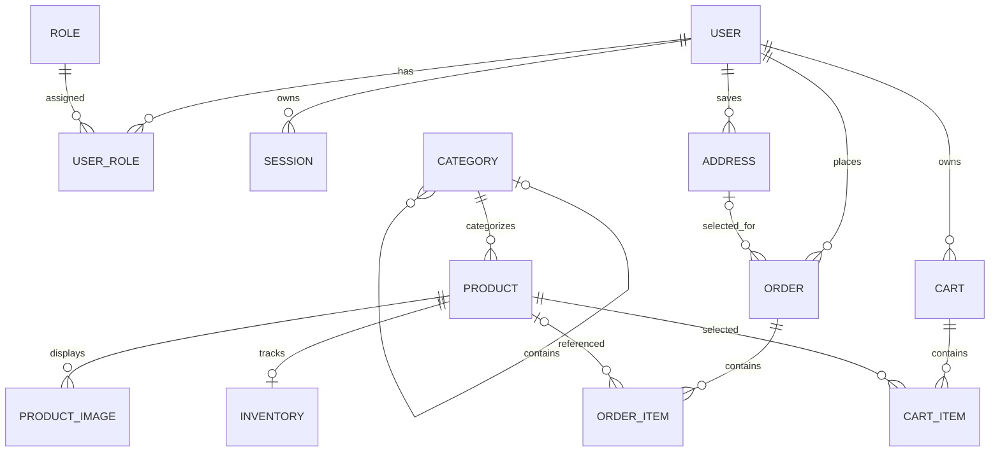

# Database Schema

This document describes the Milestone 2 PostgreSQL schema defined in
[`apps/api/prisma/schema.prisma`](../../apps/api/prisma/schema.prisma). The schema
is for the MVP and does not include payment records, product variants, guest
carts, or billing addresses.

## Conventions

- IDs are PostgreSQL UUIDs generated by Prisma.
- Timestamps use `timestamptz(6)` and are stored in UTC.
- Monetary values use `numeric(12, 2)` through Prisma `Decimal`; floating-point
  types must not be used for money.
- Products, users, and orders are retained. Product removal uses `deletedAt`;
  users are deactivated and anonymized rather than physically deleted; order
  records and their snapshots are preserved.
- Passwords are stored as password hashes. Session tokens are stored as hashes,
  expire after seven days, and can be revoked using `revokedAt`. The application
  must set `expiresAt` at session creation; the schema does not calculate the
  seven-day interval.
- Currency codes are explicit three-character values. The schema does not
  hardcode or infer a currency.

## Models

| Model | Fields and database types | Relationships and constraints |
|---|---|---|
| `User` | `id UUID`; `email String`; `passwordHash String`; `firstName String`; `lastName String`; `phone String?`; `isActive Boolean`; `emailVerifiedAt Timestamptz?`; `createdAt`, `updatedAt Timestamptz` | Unique email; index on `isActive`. Has roles, sessions, addresses, carts, and orders. |
| `Role` | `id UUID`; `code RoleCode`; `name String`; `description String?`; `createdAt`, `updatedAt Timestamptz` | Unique role code. `RoleCode` is `CUSTOMER` or `ADMIN`. |
| `UserRole` | `userId UUID`; `roleId UUID`; `assignedAt Timestamptz` | Composite primary key `(userId, roleId)`; index on `roleId`. User deletion cascades the join; role deletion is restricted while assigned. |
| `Session` | `id UUID`; `userId UUID`; `tokenHash String`; `expiresAt Timestamptz`; `revokedAt Timestamptz?`; `createdAt Timestamptz`; `lastSeenAt Timestamptz?` | Unique token hash; indexes on `userId` and `expiresAt`. Sessions cascade with a physical user deletion. No IP or user-agent fields. |
| `Category` | `id UUID`; `parentId UUID?`; `name String`; `slug String`; `description String?`; `isActive Boolean`; `sortOrder Int`; `createdAt`, `updatedAt Timestamptz` | Unique slug; indexes on `parentId` and `(isActive, sortOrder)`. Optional parent/children self-relation; deleting a parent sets child `parentId` to null. |
| `Product` | `id UUID`; `categoryId UUID`; `name String`; `slug String`; `sku String`; `description String`; `price Decimal(12,2)`; `compareAtPrice Decimal(12,2)?`; `currencyCode Char(3)`; `isPublished Boolean`; `deletedAt Timestamptz?`; `createdAt`, `updatedAt Timestamptz` | Unique slug and SKU; indexes on `(categoryId, isPublished, deletedAt)` and `(isPublished, deletedAt)`. Exactly one category per product. Category deletion is restricted. |
| `ProductImage` | `id UUID`; `productId UUID`; `url String`; `altText String?`; `sortOrder Int`; `createdAt Timestamptz` | Index on `(productId, sortOrder)`; image records cascade if a product is physically deleted. The URL references stored media; image bytes are not in the database. |
| `Inventory` | `productId UUID`; `quantityOnHand Int`; `updatedAt Timestamptz` | `productId` is both primary key and product FK, enforcing one inventory row per product. No reserved-quantity field. |
| `Cart` | `id UUID`; `userId UUID`; `status CartStatus`; `createdAt`, `updatedAt Timestamptz` | Index on `(userId, status)`. Status is `ACTIVE`, `CONVERTED`, or `ABANDONED`; converted carts remain stored. A partial unique index limits each user to one active cart (see [migration-phase SQL](#postgresql-constraints-for-the-migration-phase)). |
| `CartItem` | `id UUID`; `cartId UUID`; `productId UUID`; `quantity Int`; `createdAt`, `updatedAt Timestamptz` | Unique `(cartId, productId)`; index on `productId`. Cart deletion cascades to its items; product deletion is restricted while selected by a cart. |
| `Address` | `id UUID`; `userId UUID`; `label String?`; `recipientName String`; `phone String`; `line1 String`; `line2 String?`; `city String`; `region String?`; `postalCode String`; `countryCode Char(2)`; `isDefault Boolean`; `createdAt`, `updatedAt Timestamptz` | Index on `userId`. Multiple addresses per user; a partial unique index permits at most one default address per user (see [migration-phase SQL](#postgresql-constraints-for-the-migration-phase)). Physical user deletion cascades to addresses; order snapshots remain if an address is detached. |
| `Order` | `id UUID`; `orderNumber String`; `userId UUID`; `shippingAddressId UUID?`; `status OrderStatus`; `subtotal`, `shippingTotal`, `taxTotal`, `grandTotal Decimal(12,2)`; `currencyCode Char(3)`; `shippingRecipientName String`; `shippingPhone String`; `shippingLine1 String`; `shippingLine2 String?`; `shippingCity String`; `shippingRegion String?`; `shippingPostalCode String`; `shippingCountryCode Char(2)`; `placedAt`, `createdAt`, `updatedAt Timestamptz` | Unique order number; indexes on `(userId, createdAt)`, `(status, createdAt)`, and `shippingAddressId`. User deletion is restricted. Optional address FK is set null on address deletion; copied shipping fields preserve the order snapshot. |
| `OrderItem` | `id UUID`; `orderId UUID`; `productId UUID?`; `productName String`; `sku String`; `unitPrice`, `lineTotal Decimal(12,2)`; `quantity Int`; `createdAt Timestamptz` | Indexes on `orderId` and `productId`. Order deletion is restricted. Product deletion sets the optional product FK to null; item name, SKU, price, quantity, and line total are retained as a snapshot. |

`RoleCode`, `CartStatus`, and `OrderStatus` are PostgreSQL enums. Order status
values are `PENDING`, `CONFIRMED`, `PROCESSING`, `SHIPPED`, `DELIVERED`, and
`CANCELLED`.

## Mermaid ER diagram



## PostgreSQL constraints for the migration phase

Prisma's schema language describes the relational constraints, indexes, enum
types, and uniqueness rules above, but it does not express partial unique indexes
or general `CHECK` constraints. Add these SQL statements when a database
migration is implemented. No migration is created as part of this milestone.

```sql
CREATE UNIQUE INDEX "Cart_one_active_per_user"
  ON "Cart" ("userId")
  WHERE "status" = 'ACTIVE';

CREATE UNIQUE INDEX "Address_one_default_per_user"
  ON "Address" ("userId")
  WHERE "isDefault" = TRUE;

ALTER TABLE "Inventory"
  ADD CONSTRAINT "Inventory_quantityOnHand_nonnegative"
  CHECK ("quantityOnHand" >= 0);

ALTER TABLE "CartItem"
  ADD CONSTRAINT "CartItem_quantity_positive"
  CHECK ("quantity" > 0);

ALTER TABLE "OrderItem"
  ADD CONSTRAINT "OrderItem_quantity_positive"
  CHECK ("quantity" > 0);

ALTER TABLE "Product"
  ADD CONSTRAINT "Product_prices_nonnegative"
  CHECK ("price" >= 0 AND ("compareAtPrice" IS NULL OR "compareAtPrice" >= 0));

ALTER TABLE "Order"
  ADD CONSTRAINT "Order_totals_nonnegative"
  CHECK (
    "subtotal" >= 0 AND "shippingTotal" >= 0 AND
    "taxTotal" >= 0 AND "grandTotal" >= 0
  );

ALTER TABLE "OrderItem"
  ADD CONSTRAINT "OrderItem_amounts_nonnegative"
  CHECK ("unitPrice" >= 0 AND "lineTotal" >= 0);
```

The application must change an existing default address and set its replacement
within one transaction. It must likewise convert or abandon an active cart
before creating another. These state changes should be designed to handle
concurrent requests; the partial unique indexes provide the final database
guard.
